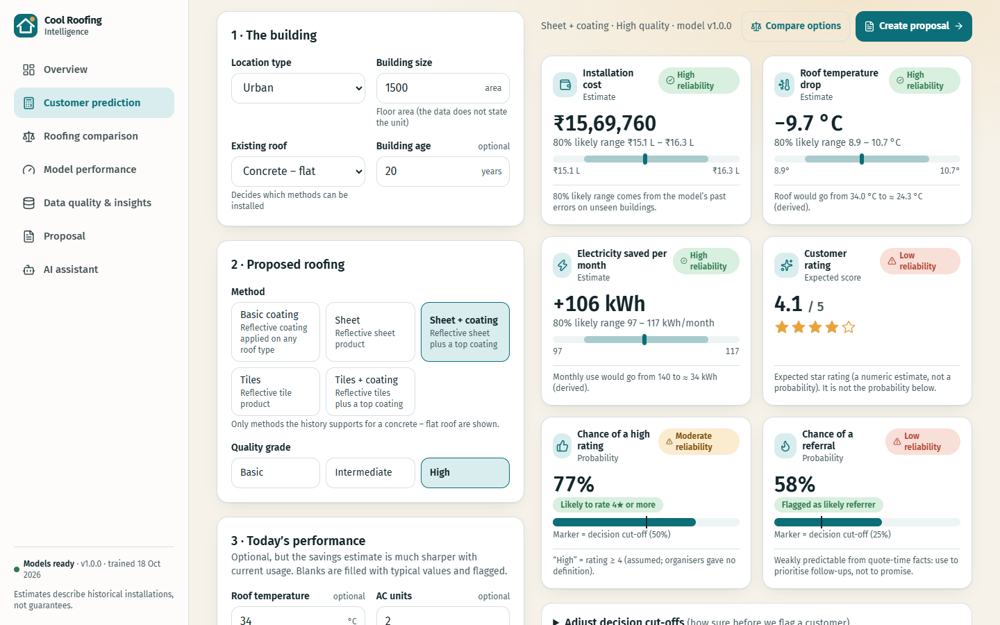
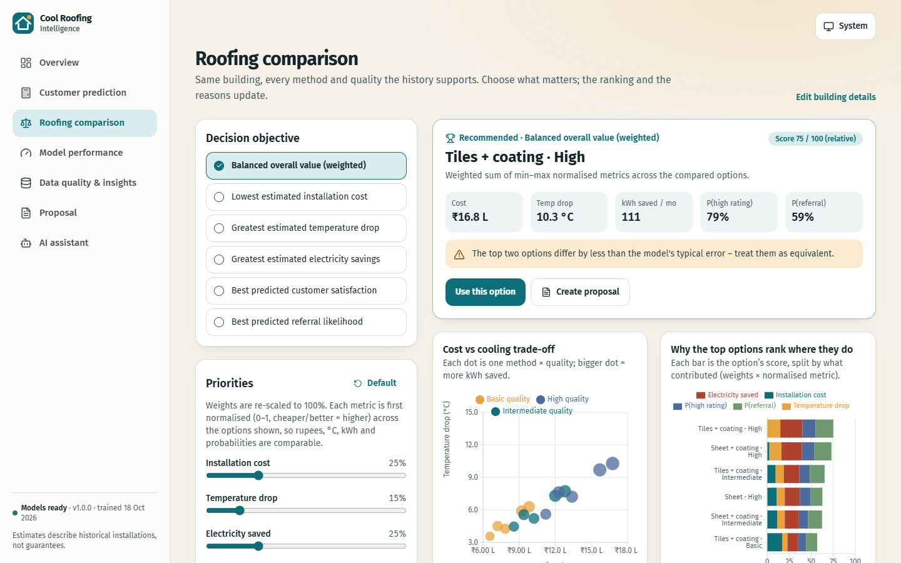
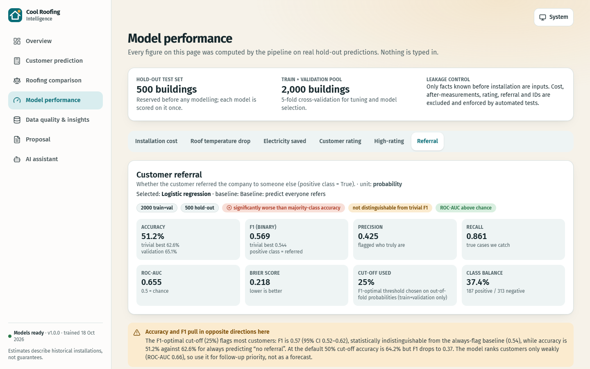
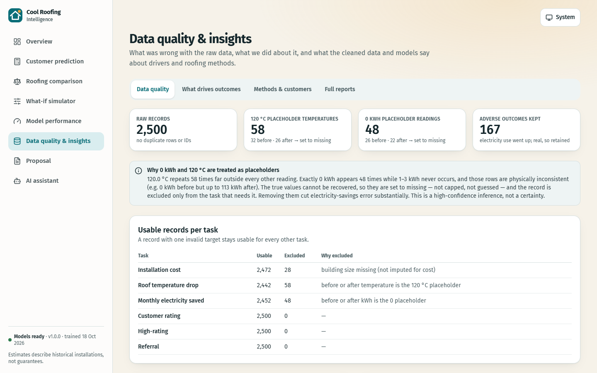
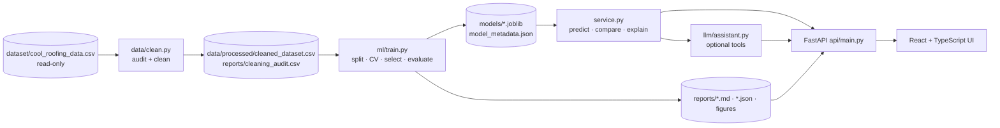

# Cool Roofing Intelligence — Cost, Comfort & Energy Savings Predictor

A working, end-to-end product for a cool-roofing company. A sales rep answers a few day-one questions about a building and gets **honest, explained estimates** of the five things a customer asks about — plus a transparent comparison of roofing options and a customer-ready PDF proposal.

> **Machine-learning decision support for cool (heat-reflective) roofing.** Trained on 2,500 historical installations in India, it predicts installation cost, roof-temperature drop, monthly electricity savings, customer rating and referral, compares every valid roofing option, explains each estimate and generates a customer proposal PDF. Built with Python, scikit-learn, LightGBM, FastAPI and React + TypeScript.

**What's inside**
- **Data audit and cleaning**: finds hidden placeholders (58 readings of 120 °C, 48 suspected 0 kWh) and keeps a record-level audit trail; no row is deleted.
- **6 models for 5 tasks**, evaluated on 500 held-out buildings against baselines, with bootstrap significance tests and an independent leakage/provenance review.
- **Roofing-option comparison** with transparent, adjustable scoring, plus a **what-if simulator**.
- **Explanations** per customer (exact Shapley values) and global insights.
- **PDF proposals** and an optional **AI sales assistant** (free built-in mode, or Gemini/Groq/Ollama/Claude).
- **FastAPI backend + React/TypeScript/Tailwind web app**; 153 backend and 30 UI tests (including accessibility checks).

**Tech stack:** Python · pandas · scikit-learn · LightGBM · FastAPI · ReportLab · React 19 · TypeScript · Vite · Tailwind CSS · Recharts

| Question | Output | Required metrics (hold-out) |
|---|---|---|
| A. How much will it cost? | INR + likely range | MAE, RMSE |
| B. How much will the roof cool? | °C drop + likely range | MAE, RMSE |
| C. How much electricity per month? | kWh/month saved + likely range | MAE, RMSE |
| D. Will the customer rate it highly? | expected stars (MAE) and P(rating ≥ 4) (accuracy) | MAE, Accuracy |
| E. Will they refer us? | probability + decision | Accuracy, F1 |

> Everything below is computed by the code in this repository on the supplied 2,500-record CSV. Nothing is hand-typed or mocked in the product.

## Results at a glance (hold-out: 500 unseen buildings)

| Task | Selected model | Metric | Baseline | **Hold-out** | n train+val / test |
|---|---|---|---:|---:|---|
| Installation cost | Log-linear ridge (multiplicative) | MAE / RMSE (₹) | 637,024 / 823,818 | **25,299 / 38,515** (R² 0.998) | 1,979 / 493 |
| Roof temperature drop | LightGBM on drop-fraction × start temp. | MAE / RMSE (°C) | 1.797 / 2.239 | **0.414 / 0.512** (R² 0.948) | 1,956 / 486 |
| Monthly electricity saved | LightGBM on saved-fraction × current use | MAE / RMSE (kWh) | 38.35 / 51.05 | **3.62 / 5.87** (R² 0.987) | 1,958 / 494 |
| Customer rating (1–5) | LightGBM | MAE (stars) | 0.924 | **0.769** (R² 0.36) | 2,000 / 500 |
| High rating (≥ 4) | LightGBM classifier | Accuracy · F1 | 0.576 · 0.596 (best trivial) | **0.688 · 0.614** (ROC-AUC 0.76) | 2,000 / 500 |
| Referral | Logistic regression | F1 · Accuracy | 0.544 · 0.626 (best trivial) | **F1 0.569 · acc 0.512** (ROC-AUC 0.66) | 2,000 / 500 |

**Read this honestly.**
- Cost, cooling and savings are predicted precisely (the electricity model improved markedly once the 0 kWh placeholder readings were found and removed).
- **Rating and referral are only weakly predictable from quote-time facts.** Paired bootstrap against pre-declared trivial baselines (`docs/model_review.md`): the referral model's F1 (0.569) is **not distinguishable** from "predict everyone refers" (0.544; CI of the gain −0.005…+0.053) and, at its F1-optimal 25 % cut-off, its accuracy (0.512) is **significantly worse** than the majority class (0.626); at a 50 % cut-off accuracy is 0.642 but F1 falls to 0.367. It does rank customers better than chance (ROC-AUC 0.655, 95 % CI 0.61–0.70). High-rating accuracy is significantly better than the majority class (+0.112, CI +0.056…+0.166) but its F1 is not distinguishable from "everyone is high". Accuracy and F1 pull in opposite directions, so both are reported, the cut-off is selectable in the app, and a diagnostic shows even *oracle* knowledge of realised savings gives only 0.68 AUC for referral — the signal is mostly outside the data.
- MAE/RMSE above are **model errors on unseen buildings, not customer savings**.

Independent review (leakage, provenance, replication): [`docs/model_review.md`](docs/model_review.md) · Full detail: [`docs/model_evaluation.md`](docs/model_evaluation.md) · [`docs/data_quality_report.md`](docs/data_quality_report.md) · [`docs/business_recommendations.md`](docs/business_recommendations.md).

## Key findings from the data audit
- **Roof temperature = 120 °C** in 58 records (32 before, 26 after): a placeholder → set to missing, record excluded from the temperature task only.
- **Exactly 0 kWh** in 48 readings (26 before, 22 after): no values at 1–3 kWh exist while 4–8 kWh do, and rows are physically inconsistent → placeholders, set to missing (inference documented as high-confidence, not certain).
- **167 records where electricity use went *up*** are kept as genuine adverse outcomes.
- 164 rows have a missing or invalidated input; imputed inside training folds only.
- Tile products never occur on sheet roofs (and vice versa); the app only offers supported combinations.

## Business answer
No single method wins everywhere, but **coated products (sheet + coating, tiles + coating) are consistently strongest** on cooling, savings, predicted satisfaction and referral; basic coating is cheapest but weakest and not good value per °C. Electricity savings alone do not pay back the roof at realistic tariffs (break-even tariff ≈ ₹147–191/kWh for 10 years), so the case rests on comfort and benefits the data does not measure. See [`docs/business_recommendations.md`](docs/business_recommendations.md).

## Screenshots
| Customer prediction | Roofing comparison |
|---|---|
|  |  |
| **Model performance** | **Data-quality insights** |
|  |  |

## What-if simulator
`What-if simulator` (sidebar) starts from the customer on the prediction page, lets you change inputs or the roofing method/quality, and **Run simulation** shows baseline vs scenario for cost, temperature reduction and electricity saved plus a chart of every valid roofing option. Every number comes from the existing `/api/predict` and `/api/compare` endpoints and trained models; nothing is computed in the browser.

## Quick start

Requirements: Python ≥ 3.10, Node ≥ 20 (for the UI).

```bash
# 1. Python environment
python -m venv .venv && source .venv/bin/activate        # Windows: .venv\Scripts\activate
pip install -r requirements.txt
pip install -e . --no-deps

# 2. Reproduce everything from the raw CSV (audit -> clean -> train -> evaluate -> insights), ~10 min
python -m coolroof all

# 3. Build the UI once, then start the product (API + UI on http://127.0.0.1:8000)
cd frontend && npm ci && npm run build && cd ..
python -m coolroof serve
```

Development mode with hot reload: run `python -m coolroof serve` (port 8000) and, in `frontend/`, `npm run dev` (port 5173, proxies `/api`). Interactive API docs: <http://127.0.0.1:8000/docs>.

Individual stages: `python -m coolroof data | train | insights`.

### Run the tests
```bash
python -m pytest            # 153 backend tests (data, leakage, ML, independent model review, recommendation, API, assistant providers)
cd frontend && npm test     # 30 UI tests incl. axe accessibility checks and the what-if simulator
cd frontend && npm run typecheck
```
Backend tests that need trained models use the artifacts from `python -m coolroof all`; training is also exercised end-to-end in fast mode inside the tests.

### AI sales assistant (free options, no Claude needed)
It works out of the box with **no key**: the built-in assistant is free and offline. For a conversational LLM, set one provider in `.env` (see `.env.example`):

| Provider | Cost | Setting |
|---|---|---|
| built-in | free, no account | `COOLROOF_LLM_PROVIDER=builtin` (default) |
| Google Gemini | free tier | `COOLROOF_LLM_PROVIDER=gemini` + `GEMINI_API_KEY` (key from Google AI Studio; default model `gemini-flash-lite-latest`; the free tier has a small daily request limit, and the app falls back to the built-in assistant when it is reached) |
| Groq / OpenRouter | free tiers | `groq` + `GROQ_API_KEY`, or `openrouter` + `OPENROUTER_API_KEY` |
| Ollama (local) | free | `ollama` (+ `ollama pull llama3.1`) |
| any OpenAI-compatible server | varies | `openai_compat` + `COOLROOF_LLM_BASE_URL` + `COOLROOF_LLM_API_KEY` |
| Claude | paid credit | `anthropic` + `ANTHROPIC_API_KEY` |

Every provider can only call validated tools into the real models; none can compute or invent predictions. In `auto` mode (no explicit provider) a failing provider falls back to the built-in assistant. Never commit `.env` (it is git-ignored).

## Architecture



```
cool_roofing_data.csv ─► data/ (audit, clean, profile) ─► features.py (contract, leakage guards, pipelines)
                       ─► ml/ (candidates, train, evaluation, insights) ─► models/ + reports/
service.py ─ recommend.py (scoring, ROI) ─ proposal.py (PDF) ─► api/ (FastAPI) ─► frontend/ (React/Vite/Tailwind)
```
Details: [`docs/architecture.md`](docs/architecture.md).

## Repository layout
```
dataset/                 source CSV (never modified)      data/raw/   archived copy + checksum test
src/coolroof/            config · features · service · recommend · proposal · cli
  data/                  clean.py (audit+clean) · report.py (profile, figures, markdown)
  ml/                    candidates · train · metrics · split · evaluation_report · insights · business_report
  api/                   FastAPI app + request schemas        llm/  optional assistant
frontend/                React 19 + TS + Vite + Tailwind 4 + Recharts (+ Vitest)
models/                  trained models + metadata (generated)
reports/ docs/           generated reports and written documentation
tests/                   pytest suite
```

## Method in brief
- **Cleaning**: record-level audit trail (`reports/cleaning_audit.csv`); invalid values become missing, never silently capped or dropped; per-task eligibility; raw file untouched.
- **Leakage control**: only nine pre-installation inputs; cost, after-measurements, rating, referral and IDs are forbidden and enforced by code, API schemas and tests ([`docs/feature_contract.md`](docs/feature_contract.md)).
- **Protocol**: 20 % hold-out fixed first (stratified on rating); 5-fold CV inside the rest for tuning/selection; preprocessing fitted on training folds only; the selected model and baseline are scored on the hold-out once. Metrics reported with trivial baselines (mean/median; majority and "everyone positive" for classifiers).
- **Candidates**: baseline, interpretable benchmark (linear / log-linear / pairwise-interaction ridge / logistic), random forest, LightGBM (plain, log-target, ratio-target). Winners are chosen by validation metric, not by sophistication — the log-linear ridge beats boosting for cost.
- **Uncertainty**: empirical out-of-fold intervals (hold-out coverage of the 80 % interval: 78 % cost, 79 % cooling, 76 % savings), calibration checks for probabilities.
- **Explanations**: global permutation importance, counterfactual method/quality effects with bootstrap intervals, segment error analysis, and exact per-customer Shapley values.
- **Recommendation**: valid method×quality options only; single objectives or a weighted score over min–max-normalised metrics (documented, adjustable weights, scores explicitly relative); satisfaction uses P(high rating), never the star estimate.
- **Economics**: payback only from a user-entered tariff; tariff-free break-even tariff otherwise.

## Assumptions (all configurable and shown in the product)
"High rating" = rating ≥ 4 (undefined by organisers) · electricity is monthly kWh · building size has no stated unit · the evaluation-metrics image was not supplied, so the metrics in the written brief were used. Full log: [`docs/assumptions_and_decisions.md`](docs/assumptions_and_decisions.md).

## Known limitations
- Rating and referral models carry real but modest signal; use for prioritisation, not promises.
- One random split of 2,500 buildings; no time/location fields, so drift and regional effects are untestable.
- Method/quality effects are associations from observational data (possible confounding), not causal.
- The 0 kWh / 120 °C placeholder treatment is an inference from the value distribution.
- Prediction intervals under-cover slightly for cost and savings (≈ 76–78 % vs 80 % nominal).
- The production hold-out overlapped my early exploration split at design level (disclosed; a from-scratch replication on never-explored rows gives the same results, `docs/model_review.md`).
- Single-process local deployment; see the runbook for production notes.

## Deployment considerations
Serve the FastAPI app behind a reverse proxy with TLS; models load once at start-up (no retraining at request time); set `COOLROOF_CORS_ORIGINS` for a separate UI origin; keep `ANTHROPIC_API_KEY` in the environment/secret store; retrain with `python -m coolroof all` when new installation records arrive (the pipeline is deterministic — seed 42 — and writes versioned metadata including the data checksum). Add authentication and rate limiting before exposing it publicly. See [`docs/runbook.md`](docs/runbook.md).
