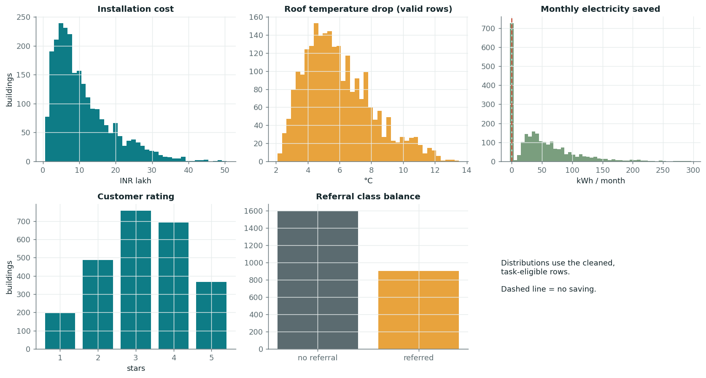
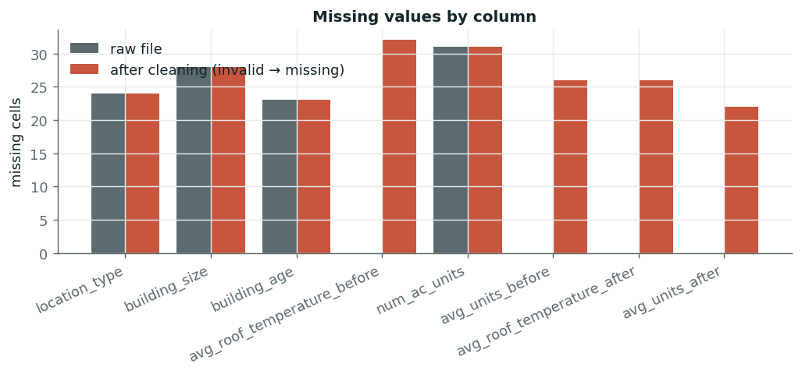
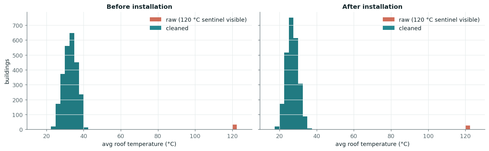
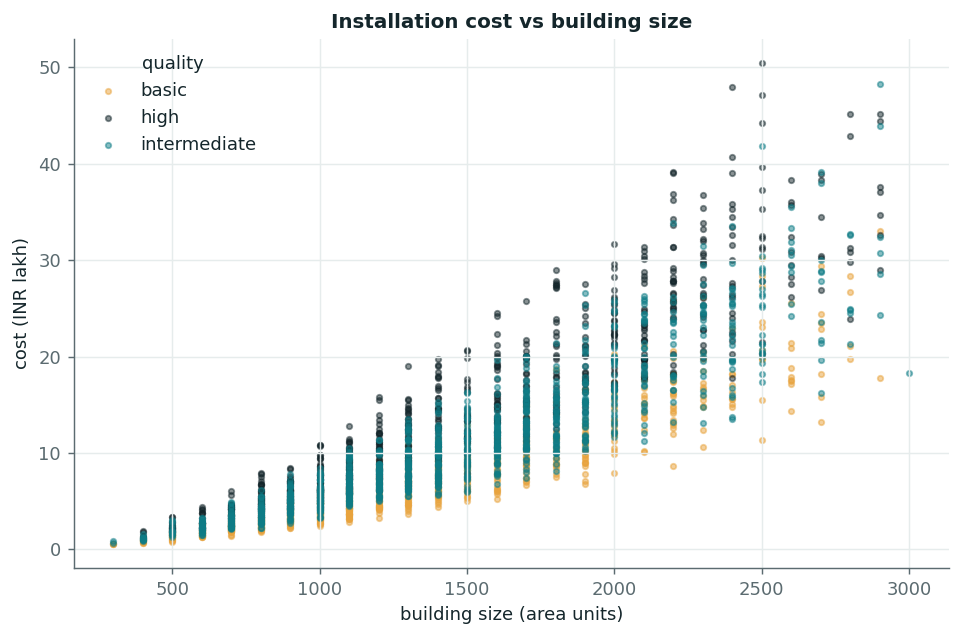
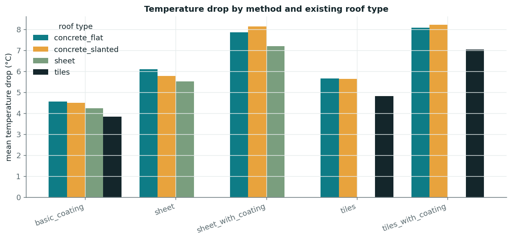
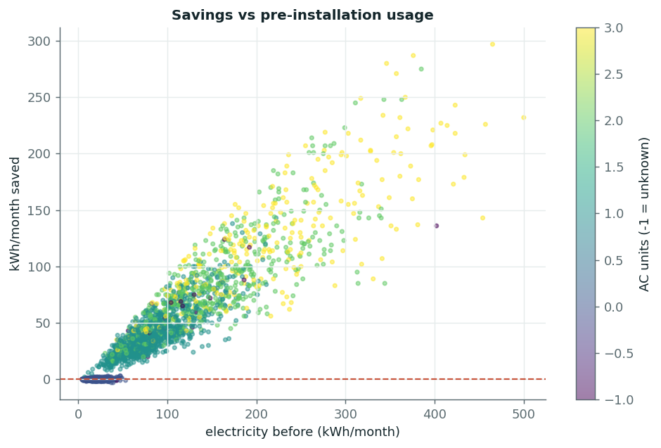
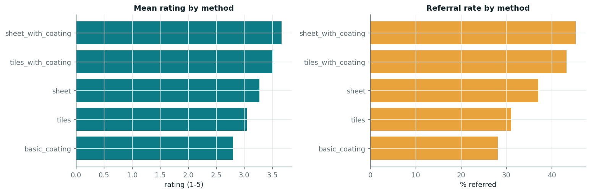

# Data Quality & Cleaning Report

_Generated by `coolroof data` from the real CSV. Every number below is computed, not typed._

## 1. Structure
- Rows: **2,500**, columns: **15** (all 15 expected columns present).
- Duplicate rows: **0**; duplicate `building_id`: **0**; duplicates when ignoring the id: **0**.
- `building_id` is a unique sequential record number (1..N). It carries no business meaning, so it is **never used as a feature**.
- Unexpected category labels: **0**; labels are already lower-case/trimmed (0 changes needed).
- Numeric columns all parsed as numbers; `customer_referral` parsed as boolean.

## 2. Missing values
| column | missing (raw) | missing (after cleaning) |
|---|---:|---:|
| `location_type` | 24 | 24 |
| `building_size` | 28 | 28 |
| `building_age` | 23 | 23 |
| `avg_roof_temperature_before` | 0 | 32 |
| `num_ac_units` | 31 | 31 |
| `avg_units_before` | 0 | 26 |
| `avg_roof_temperature_after` | 0 | 26 |
| `avg_units_after` | 0 | 22 |

Rows with at least one missing/invalid *feature* after cleaning: **164** of 2,500. Missing features are imputed **inside each training fold** (median / most-frequent plus a missing-indicator), never on the held-out set.

## 3. Anomalies and decisions
### 3.1 Roof temperature = 120 °C (invalid)
- **32** records have `avg_roof_temperature_before = 120.0` and **26** have `avg_roof_temperature_after = 120.0` (never both on one record).
- Every other reading lies in a tight, physical band; 120 °C is a repeated placeholder far outside it, and the implied 'temperature drop' would be ±90 °C versus a valid range of 2.1–13.5 °C.
- **Decision:** the value cannot be recovered, so it is set to missing (not capped, not guessed). A record with an invalid *before/after* temperature is excluded from the temperature-drop task only; an invalid *before* temperature is also imputed when used as a feature for the other tasks.

### 3.2 Electricity readings of exactly 0 kWh (invalid placeholder)
- `avg_units_before = 0` in **26** records and `avg_units_after = 0` in **22** (never both).
- Evidence they are not real readings: (1) the value distribution has a spike at 0 but **no values at 1–3 kWh**, with the natural lower tail starting near 4–5 kWh; (2) the records are physically inconsistent: `before = 0` rows report up to **113 kWh after** (often with 1–2 AC units), and `after = 0` rows had up to **273 kWh before** (often with 3 AC units) – an after/before ratio of exactly 0, while the smallest ratio among all valid records is **0.078**.
- **Decision:** set to missing (the true value is unrecoverable). The record is excluded from the electricity-savings task only; an invalid *before* value is imputed (training-fold median + missing-indicator) when used as a feature elsewhere. This is stated as a high-confidence inference, not a certainty.

### 3.3 Electricity use higher after installation (valid but undesirable)
- **167** records have `avg_units_after > avg_units_before` (negative savings) and **404** have exactly zero savings.
- 99% of the negative-saving buildings have no AC units and the median pre-installation usage is 17 kWh/month: they are small base-load buildings where a cooler roof has nothing to save and ordinary month-to-month variation dominates.
- **Decision:** kept. These are genuine outcomes the company must be able to warn customers about; deleting them would make the savings model look better than reality.

### 3.4 Exactly-zero savings are kept
- 404 records have `units_saved = 0`. They are almost all low-usage buildings without AC, where a cooler roof has no cooling load to reduce – physically coherent, so retained.

### 3.5 Other checks that found nothing
- non-positive or extreme cost (cost per unit area vs. method×quality median): **0 records**
- building size / age / AC-count out of range or non-integer: **0 records**
- rating outside 1–5 or non-integer: **0 records**
- referral flag missing or not boolean: **0 records**
- roof temperature after > before (excluding the sentinel rows): **0 records**
- incompatible roof-type × method combinations (e.g. tile product on a sheet roof): **0 records**
- negative electricity consumption: **0 records**

## 4. Task-specific sample counts
| task | usable records | excluded | why |
|---|---:|---:|---|
| Installation cost | 2,472 | 28 | building_size missing (size drives cost; not imputed for this task) |
| Roof temperature drop | 2,442 | 58 | before or after temperature is the 120 °C sentinel |
| Monthly electricity saved | 2,452 | 48 | avg_units_before or avg_units_after is the 0 kWh placeholder |
| Customer rating (1-5) | 2,500 | 0 | none |
| High rating (>= threshold) | 2,500 | 0 | none |
| Customer referral | 2,500 | 0 | none |

Records excluded from **every** task: **0**.

## 5. Assumptions
- **units**: avg_units_* are monthly kWh (stated in the problem statement: 'average monthly electricity consumption (kWh)')
- **building_size_unit**: not stated in the problem statement ('floor area'); treated as an opaque area unit, shown as 'area units' / sq ft in the UI
- **high_rating_threshold**: 4

## 6. Remaining limitations
- Other silent artefacts that look plausible cannot be detected from values alone.
- The 0 kWh and 120 °C placeholders suggest a logger/migration artefact; treating them as missing is an inference from the value distribution and physical consistency, not a confirmed fact.
- No timestamp or location identifier exists, so temporal or geographic leakage/drift cannot be tested. Rows are treated as independent buildings.
- `building_size` has no stated unit; relative effects are valid, absolute 'sq ft' wording is an assumption.

## 7. Figures

