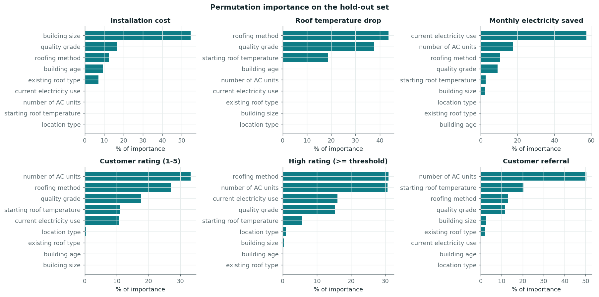
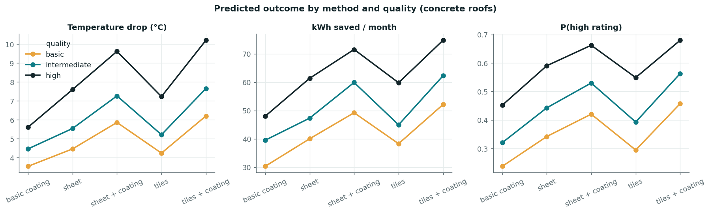

# Business Insights

_Computed by `coolroof insights` from the trained models and the cleaned data. These are **associations in historical installations**, not proven causal effects: method and quality may have been chosen by customers for reasons the data does not record._

## 1. What drives each outcome (permutation importance, hold-out)
Share of the total drop in model skill when a feature is shuffled. This is a *global* view; per-customer explanations are in the app.

| Outcome | Top drivers (share of importance) |
|---|---|
| Installation cost | building size (55%), quality grade (17%), roofing method (12%), building age (9%) |
| Roof temperature drop | roofing method (44%), quality grade (38%), starting roof temperature (19%), building age (0%) |
| Monthly electricity saved | current electricity use (57%), number of AC units (17%), roofing method (10%), quality grade (9%) |
| Customer rating (1-5) | number of AC units (33%), roofing method (27%), quality grade (18%), starting roof temperature (11%) |
| High rating (>= threshold) | roofing method (31%), number of AC units (31%), current electricity use (16%), quality grade (15%) |
| Customer referral | number of AC units (50%), starting roof temperature (20%), roofing method (13%), quality grade (11%) |

## 2. How method and quality compare (model-based counterfactuals)
For each option we set every comparable building's method (or quality) to that option and average the model's prediction. The method comparison uses the **1,323 concrete-roof buildings**, the only roofs that accept all five methods, so the building mix is identical for each method. Intervals are bootstrap intervals over buildings and **exclude model error and confounding**; read them as 'how much the average shift varies across buildings', not as certainty.

| Method (concrete roofs) | Avg cost (₹) | Temp drop (°C) | kWh saved / month | P(high rating) | P(referral) |
|---|---:|---:|---:|---:|---:|
| basic coating | 893,144 | 4.64 | 40.8 | 34.8% | 31.8% |
| sheet | 979,356 | 6.00 | 51.0 | 47.1% | 39.8% |
| sheet + coating | 1,251,011 | 7.75 | 62.1 | 55.0% | 47.0% |
| tiles | 1,066,563 | 5.68 | 49.1 | 42.5% | 34.8% |
| tiles + coating | 1,335,396 | 8.20 | 64.9 | 57.7% | 47.9% |

| Quality (all buildings) | Avg cost (₹) | Temp drop (°C) | kWh saved / month | P(high rating) | P(referral) |
|---|---:|---:|---:|---:|---:|
| basic | 808,751 | 4.57 | 36.5 | 32.1% | 31.2% |
| intermediate | 1,053,671 | 5.68 | 44.3 | 40.7% | 35.9% |
| high | 1,379,208 | 7.56 | 54.5 | 53.8% | 39.8% |

### Value for money (method × quality, concrete roofs)
Tariff-free efficiency: rupees paid per °C of temperature drop and per kWh/month saved (lower is better).

| Method | Quality | Cost (₹) | ₹ per °C drop | ₹ per kWh/month saved | P(high rating) | P(referral) |
|---|---|---:|---:|---:|---:|---:|
| sheet + coating | basic | 904,858 | 154,404 | 18,389 | 42.0% | 41.4% |
| tiles + coating | basic | 965,893 | 155,694 | 18,537 | 45.7% | 42.3% |
| sheet | high | 1,208,021 | 158,894 | 19,688 | 59.0% | 43.7% |
| sheet | basic | 708,369 | 158,937 | 17,700 | 34.2% | 34.4% |
| sheet + coating | high | 1,543,104 | 160,288 | 21,568 | 66.2% | 51.0% |
| tiles + coating | high | 1,647,192 | 161,286 | 22,030 | 68.0% | 52.0% |
| sheet + coating | intermediate | 1,178,883 | 162,207 | 19,684 | 53.0% | 46.7% |
| tiles + coating | intermediate | 1,258,402 | 164,349 | 20,212 | 56.3% | 47.7% |
| sheet | intermediate | 922,890 | 166,601 | 19,510 | 44.3% | 39.5% |
| tiles | high | 1,315,590 | 181,919 | 22,001 | 54.9% | 38.5% |
| tiles | basic | 771,446 | 182,153 | 20,150 | 29.5% | 29.7% |
| basic coating | basic | 646,012 | 182,717 | 21,320 | 23.7% | 26.9% |
| basic coating | intermediate | 841,648 | 188,725 | 21,305 | 32.0% | 31.4% |
| tiles | intermediate | 1,005,069 | 192,895 | 22,362 | 39.3% | 34.5% |
| basic coating | high | 1,101,680 | 196,456 | 22,966 | 45.2% | 35.3% |

### Can electricity savings alone pay for the roof?
The data contains no tariff, so none is assumed. Instead, the **break-even tariff** is the electricity price (₹/kWh) at which the predicted monthly savings would repay the average installation cost in 10 years (no maintenance, no escalation):

- lowest across the 15 method × quality options: **₹147/kWh** (sheet, basic); highest: ₹191/kWh (basic coating, high).
- Compare that with the customer's actual tariff in the app. If it is far below these values, the investment has to be justified by benefits this dataset does not measure (comfort, roof protection, sustainability goals) rather than by the electricity bill.

### Method comparison on each existing roof type
Same counterfactual idea, restricted to the methods the data supports for that roof (quality left at each building's own value).

**concrete_flat** (n = 795 buildings)

| Method | Avg cost (₹) | Temp drop (°C) | kWh saved / month | P(high rating) | P(referral) |
|---|---:|---:|---:|---:|---:|
| basic coating | 880,509 | 4.66 | 41.0 | 35.3% | 31.7% |
| sheet | 965,502 | 6.01 | 51.0 | 47.4% | 39.7% |
| sheet + coating | 1,233,315 | 7.77 | 62.4 | 54.9% | 46.9% |
| tiles | 1,051,475 | 5.69 | 48.8 | 42.8% | 34.7% |
| tiles + coating | 1,316,506 | 8.23 | 65.2 | 58.2% | 47.9% |

**concrete_slanted** (n = 528 buildings)

| Method | Avg cost (₹) | Temp drop (°C) | kWh saved / month | P(high rating) | P(referral) |
|---|---:|---:|---:|---:|---:|
| basic coating | 912,167 | 4.61 | 40.5 | 34.1% | 31.8% |
| sheet | 1,000,215 | 5.98 | 51.1 | 46.5% | 39.8% |
| sheet + coating | 1,277,657 | 7.73 | 61.5 | 55.1% | 47.0% |
| tiles | 1,089,280 | 5.67 | 49.5 | 42.0% | 34.8% |
| tiles + coating | 1,363,839 | 8.16 | 64.3 | 57.0% | 48.0% |

**sheet** (n = 503 buildings)

| Method | Avg cost (₹) | Temp drop (°C) | kWh saved / month | P(high rating) | P(referral) |
|---|---:|---:|---:|---:|---:|
| basic coating | 722,289 | 4.24 | 33.7 | 30.5% | 25.3% |
| sheet | 792,009 | 5.46 | 41.9 | 42.0% | 32.4% |
| sheet + coating | 1,011,699 | 7.14 | 50.8 | 50.5% | 39.0% |

**tiles** (n = 674 buildings)

| Method | Avg cost (₹) | Temp drop (°C) | kWh saved / month | P(high rating) | P(referral) |
|---|---:|---:|---:|---:|---:|
| basic coating | 1,018,454 | 3.92 | 27.7 | 24.8% | 24.4% |
| tiles | 1,216,204 | 4.79 | 33.2 | 31.7% | 26.9% |
| tiles + coating | 1,522,755 | 6.94 | 42.6 | 44.8% | 38.7% |

## 3. Who is good business — knowable before installation
Observed rates (no model) by customer segment, with 95% Wilson intervals. Segments with fewer than 30 buildings are marked and should not drive decisions.

**Number of AC units**

| Segment | n | Mean kWh saved | Mean rating | High-rating rate | Referral rate |
|---|---:|---:|---:|---:|---:|
| 0 AC | 733 | -0.0 | 2.42 | 16.5% (14%–19%) | 21.1% (18%–24%) |
| 1 AC | 957 | 40.6 | 3.56 | 53.4% (50%–57%) | 41.6% (39%–45%) |
| 2 AC | 509 | 83.3 | 3.56 | 53.6% (49%–58%) | 45.6% (41%–50%) |
| 3 AC | 270 | 120.5 | 3.52 | 52.2% (46%–58%) | 41.5% (36%–47%) |
| unknown | 31 | 46.4 | 3.13 | 45.2% (29%–62%) | 22.6% (11%–40%) |

**Current monthly electricity use**

| Segment | n | Mean kWh saved | Mean rating | High-rating rate | Referral rate |
|---|---:|---:|---:|---:|---:|
| ≤25 kWh | 632 | 0.1 | 2.42 | 16.0% (13%–19%) | 20.4% (17%–24%) |
| 26–75 kWh | 592 | 22.6 | 3.22 | 43.1% (39%–47%) | 31.6% (28%–35%) |
| 76–150 kWh | 774 | 56.0 | 3.55 | 52.8% (49%–56%) | 43.4% (40%–47%) |
| >150 kWh | 476 | 121.2 | 3.75 | 59.7% (55%–64%) | 50.8% (46%–55%) |

## 4. Predictability limits (honesty check)
- Using only quote-time information, referral has hold-out ROC-AUC 0.66 and high rating 0.76.
- **Diagnostic (not a model):** even if the *realised* savings and temperature drop were known, referral AUC would only reach 0.68; adding the realised rating gives 0.78. High-rating AUC from realised outcomes is 0.79, barely above the quote-time model. So referral behaviour is mostly driven by factors outside this dataset; the pre-installation model is close to the practical ceiling and should be used for ranking/triage, not promises.

## 5. Where the models are less reliable (out-of-fold error by segment)
- **Installation cost**: largest errors in size_band = large (MAE 47,508.76 INR, n=638); cool_roofing_quality = high (MAE 34,494.70 INR, n=579); cool_roofing_method = tiles_with_coating (MAE 32,770.07 INR, n=396). Smallest: size_band = small (10,213.64).
- **Roof temperature drop**: largest errors in cool_roofing_quality = high (MAE 0.55 °C, n=573); cool_roofing_method = tiles_with_coating (MAE 0.52 °C, n=389); location_type = dense_urban (MAE 0.50 °C, n=296). Smallest: cool_roofing_quality = basic (0.31).
- **Monthly electricity saved**: largest errors in location_type = dense_urban (MAE 5.25 kWh/month, n=286); cool_roofing_quality = high (MAE 3.95 kWh/month, n=581); cool_roofing_method = sheet_with_coating (MAE 3.92 kWh/month, n=335). Smallest: location_type = rural (2.26).

(Full table: `reports/segment_error_analysis.csv`.)
