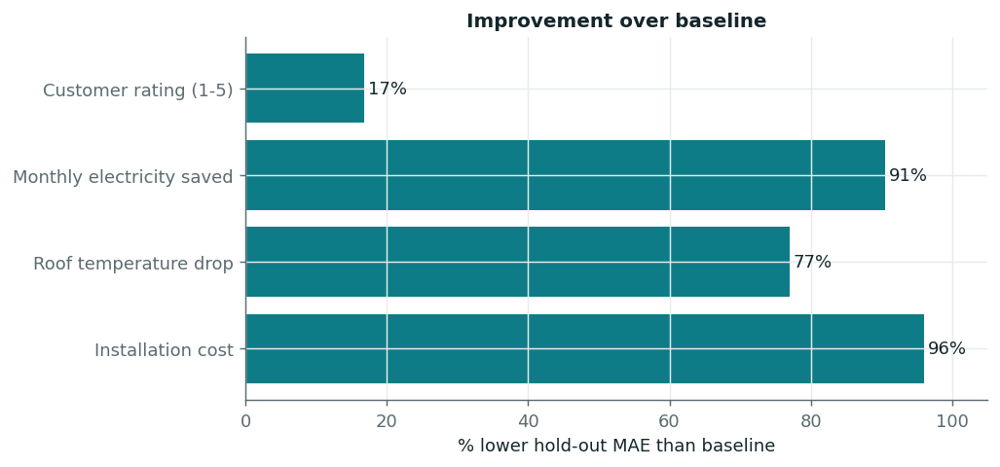
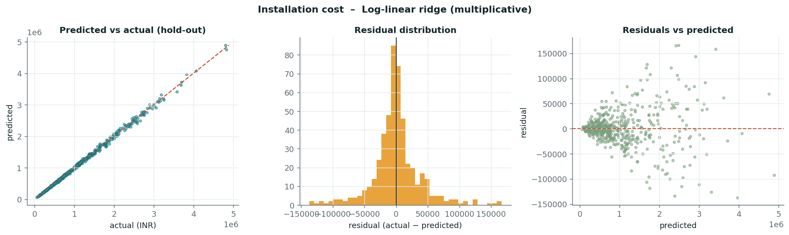
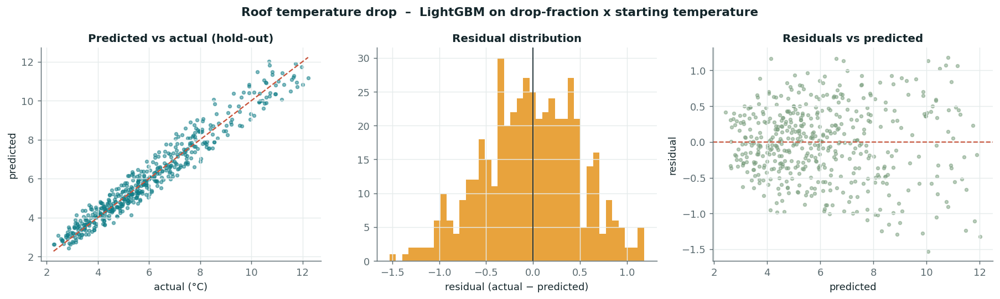
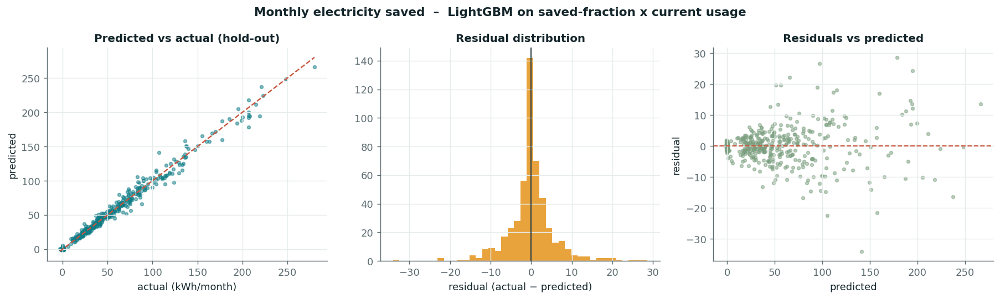
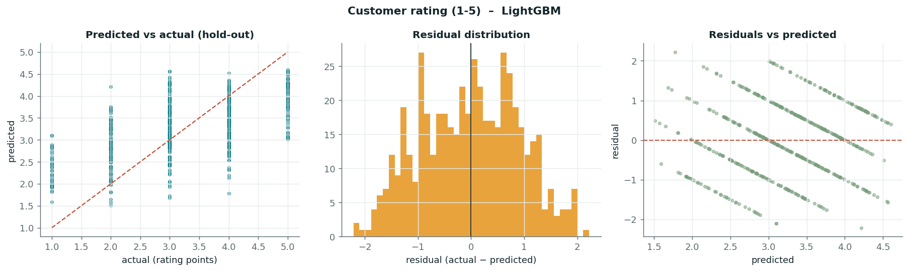
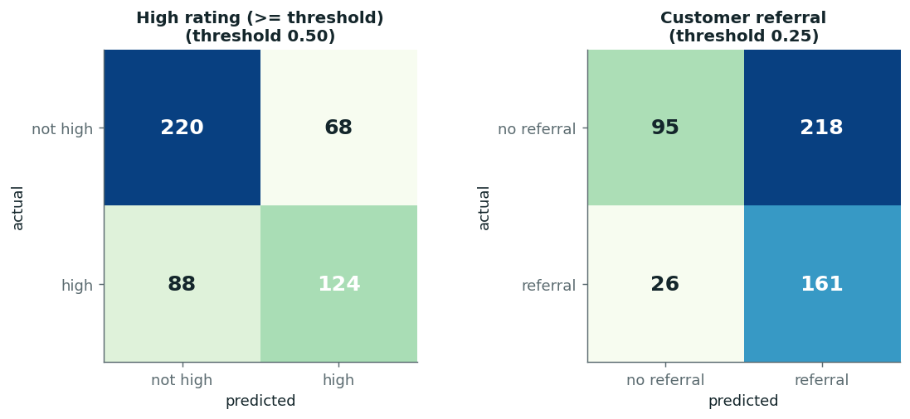
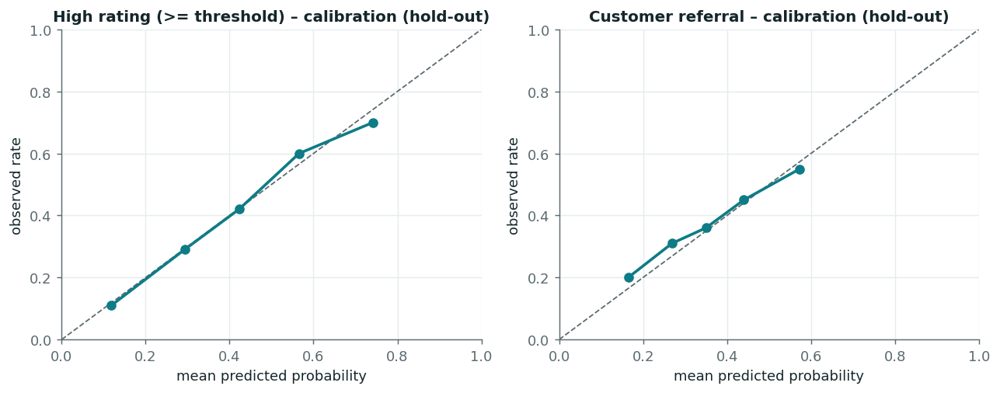

# Model Evaluation Report

_Model version 1.0.0 · trained 2026-10-18T10:54:30+00:00 · seed 42 · scikit-learn 1.7.2 · LightGBM 4.7.0_

## 1. Evaluation protocol
- 500 of 2,500 buildings (20%) were set aside as a **hold-out test set before any modelling** (stratified on the 1–5 rating). They were scored once, for the selected model and the baseline only.
- The other 2,000 buildings form the train+validation pool. Every candidate was tuned with 5-fold cross-validation inside that pool; its **out-of-fold predictions are the 'validation' scores** used to pick the winner.
- Imputation, encoding and scaling are inside the sklearn pipelines, so they are fitted on training folds only.
- Selection criterion: lowest validation MAE (regression); highest validation accuracy at 0.5 (high rating); highest validation F1 at the best out-of-fold threshold (referral). Tuned models' validation scores are slightly optimistic (best of a search); the hold-out column is the unbiased estimate.
- Task eligibility (rows with valid targets): Installation cost 2,472 · Roof temperature drop 2,442 · Monthly electricity saved 2,452 · Customer rating (1-5) 2,500 · High rating (>= threshold) 2,500 · Customer referral 2,500 (see the data-quality report).

## 2. Unified results
| Task | Selected model | Metric | Baseline (hold-out) | Validation (CV) | **Hold-out (selected)** | n train+val / test |
|---|---|---|---:|---:|---:|---|
| Installation cost | Log-linear ridge (multiplicative) | MAE (INR) | ₹637,024 | ₹25,703 | **₹25,299** | 1,979 / 493 |
| Installation cost | Log-linear ridge (multiplicative) | RMSE (INR) | ₹823,818 | ₹44,040 | **₹38,515** | 1,979 / 493 |
| Roof temperature drop | LightGBM on drop-fraction x starting temperature | MAE (°C) | 1.797 °C | 0.412 °C | **0.414 °C** | 1,956 / 486 |
| Roof temperature drop | LightGBM on drop-fraction x starting temperature | RMSE (°C) | 2.239 °C | 0.518 °C | **0.512 °C** | 1,956 / 486 |
| Monthly electricity saved | LightGBM on saved-fraction x current usage | MAE (kWh/month) | 38.35 kWh | 3.31 kWh | **3.62 kWh** | 1,958 / 494 |
| Monthly electricity saved | LightGBM on saved-fraction x current usage | RMSE (kWh/month) | 51.05 kWh | 5.31 kWh | **5.87 kWh** | 1,958 / 494 |
| Customer rating (1-5) | LightGBM | MAE (rating points) | 0.924 | 0.784 | **0.769** | 2,000 / 500 |
| Customer rating (1-5) | LightGBM | RMSE (rating points) | 1.173 | 0.930 | **0.922** | 2,000 / 500 |
| Customer rating (1-5) | LightGBM | Accuracy of derived high/not-high (≥4) | – | 0.706 | **0.696** | 2,000 / 500 |
| High rating (>= threshold) | LightGBM | Accuracy | 0.576 | 0.689 | **0.688** | 2,000 / 500 |
| High rating (>= threshold) | LightGBM | F1 (binary, positive = high) | 0.596 | 0.679 | **0.614** | 2,000 / 500 |
| Customer referral | Logistic regression | Accuracy | 0.626 | 0.651 | **0.512** | 2,000 / 500 |
| Customer referral | Logistic regression | F1 (binary, positive = referred) | 0.544 | 0.567 | **0.569** | 2,000 / 500 |

### Is each result really better than its baseline? (paired bootstrap, 2,000 resamples, 95 %)
Baselines are declared before looking at the hold-out: training mean (median for rating); majority class of the *training* pool for accuracy; 'predict every customer positive' for F1.

| Task | Metric | Model [95 % CI] | Baseline | Improvement [95 % CI] | Verdict |
|---|---|---|---:|---|---|
| Installation cost | MAE | 2.53e+04 [2.279e+04, 2.794e+04] | 6.37e+05 | 6.117e+05 [5.672e+05, 6.598e+05] | better |
| Roof temperature drop | MAE | 0.4139 [0.3859, 0.4416] | 1.797 | 1.385 [1.271, 1.504] | better |
| Monthly electricity saved | MAE | 3.617 [3.221, 4.013] | 38.35 | 34.7 [31.75, 37.63] | better |
| Customer rating (1-5) | MAE | 0.769 [0.7263, 0.8142] | 0.924 | 0.154 [0.09699, 0.2114] | better |
| High rating (>= threshold) | Accuracy | 0.688 [0.646, 0.728] | 0.576 | +0.112 [+0.056, +0.166] | better |
| High rating (>= threshold) | F1 | 0.614 [0.557, 0.670] | 0.596 | CI -0.041 to +0.077 | not distinguishable |
| High rating (>= threshold) | ROC-AUC | 0.755 [0.712, 0.795] | 0.500 | - | above chance |
| Customer referral | Accuracy | 0.512 [0.468, 0.558] | 0.626 | -0.114 [-0.190, -0.038] | WORSE |
| Customer referral | F1 | 0.569 [0.518, 0.616] | 0.544 | CI -0.005 to +0.053 | not distinguishable |
| Customer referral | ROC-AUC | 0.655 [0.606, 0.703] | 0.500 | - | above chance |

## 3. Task details
### Installation cost  (`cost`)
- Target: Total cost of the cool-roofing intervention in INR.  Unit: **INR**
- Samples: 2,472 eligible → 1,979 train+validation, 493 hold-out.
- Selected: **Log-linear ridge (multiplicative)** (`loglinear_ridge`); strongest baseline: Baseline: training mean.
- Hold-out: MAE ₹25,299, RMSE ₹38,515, R² 0.998, bias -753.040. Baseline MAE ₹637,024 → **96% lower error**.
- Prediction intervals (empirical, from out-of-fold residuals): nominal 80% interval covers **78%** and 90% covers **88%** of hold-out buildings.
- Physical-plausibility check of hold-out predictions: nan or inf = 0, non positive = 0.
- Improvement over the baseline in MAE: 6.117e+05 (paired bootstrap 95 % CI 5.672e+05 to 6.598e+05) -> **significantly better**. MAE 95 % CI 2.279e+04-2.794e+04.

| Candidate | Family | CV MAE | CV RMSE | CV R² |
|---|---|---:|---:|---:|
| Log-linear ridge (multiplicative) ✅ | interpretable | ₹25,703 | ₹44,040 | 0.997 |
| LightGBM on cost-per-area x area | boosting | ₹34,568 | ₹59,142 | 0.995 |
| LightGBM (log target) | boosting | ₹34,811 | ₹61,014 | 0.994 |
| LightGBM | boosting | ₹40,143 | ₹70,734 | 0.992 |
| Random forest | forest | ₹91,836 | ₹157,559 | 0.962 |
| Linear regression | interpretable | ₹150,036 | ₹218,457 | 0.926 |
| Baseline: training mean | baseline | ₹625,917 | ₹806,346 | -0.001 |

### Roof temperature drop  (`temperature_drop`)
- Target: avg_roof_temperature_before - avg_roof_temperature_after.  Unit: **°C**
- Samples: 2,442 eligible → 1,956 train+validation, 486 hold-out.
- Selected: **LightGBM on drop-fraction x starting temperature** (`ratio_lightgbm`); strongest baseline: Baseline: training mean.
- Hold-out: MAE 0.414 °C, RMSE 0.512 °C, R² 0.948, bias +0.024. Baseline MAE 1.797 °C → **77% lower error**.
- Prediction intervals (empirical, from out-of-fold residuals): nominal 80% interval covers **79%** and 90% covers **88%** of hold-out buildings.
- Physical-plausibility check of hold-out predictions: nan or inf = 0, negative drop = 0, drop exceeds start temp = 0.
- Improvement over the baseline in MAE: 1.385 (paired bootstrap 95 % CI 1.271 to 1.504) -> **significantly better**. MAE 95 % CI 0.3859-0.4416.

| Candidate | Family | CV MAE | CV RMSE | CV R² |
|---|---|---:|---:|---:|
| LightGBM on drop-fraction x starting temperature ✅ | boosting | 0.412 °C | 0.518 °C | 0.940 |
| LightGBM | boosting | 0.421 °C | 0.527 °C | 0.938 |
| Random forest | forest | 0.433 °C | 0.545 °C | 0.934 |
| Ridge with pairwise interactions | interpretable | 0.443 °C | 0.567 °C | 0.928 |
| Ridge regression | interpretable | 0.508 °C | 0.648 °C | 0.907 |
| Baseline: training mean | baseline | 1.704 °C | 2.122 °C | -0.001 |

### Monthly electricity saved  (`units_saved`)
- Target: avg_units_before - avg_units_after (monthly kWh).  Unit: **kWh/month**
- Samples: 2,452 eligible → 1,958 train+validation, 494 hold-out.
- Selected: **LightGBM on saved-fraction x current usage** (`ratio_lightgbm`); strongest baseline: Baseline: training mean.
- Hold-out: MAE 3.62 kWh, RMSE 5.87 kWh, R² 0.987, bias -0.046. Baseline MAE 38.35 kWh → **91% lower error**.
- Prediction intervals (empirical, from out-of-fold residuals): nominal 80% interval covers **76%** and 90% covers **88%** of hold-out buildings.
- Physical-plausibility check of hold-out predictions: nan or inf = 0, saving exceeds usage = 0, negative saving = 60.
- Improvement over the baseline in MAE: 34.7 (paired bootstrap 95 % CI 31.75 to 37.63) -> **significantly better**. MAE 95 % CI 3.221-4.013.

| Candidate | Family | CV MAE | CV RMSE | CV R² |
|---|---|---:|---:|---:|
| LightGBM on saved-fraction x current usage ✅ | boosting | 3.31 kWh | 5.31 kWh | 0.988 |
| LightGBM | boosting | 3.83 kWh | 6.53 kWh | 0.982 |
| Ridge with pairwise interactions | interpretable | 3.86 kWh | 5.85 kWh | 0.985 |
| Random forest | forest | 5.13 kWh | 9.12 kWh | 0.964 |
| Ridge regression | interpretable | 8.32 kWh | 12.18 kWh | 0.936 |
| Baseline: training mean | baseline | 36.81 kWh | 48.19 kWh | -0.001 |

### Customer rating (1-5)  (`rating`)
- Target: Numeric 1-5 rating (MAE) plus a high-rating (>= threshold) classification (accuracy).  Unit: **rating points**
- Samples: 2,500 eligible → 2,000 train+validation, 500 hold-out.
- Selected: **LightGBM** (`lightgbm`); strongest baseline: Baseline: training median rating.
- Hold-out: MAE 0.769, RMSE 0.922, R² 0.361, bias +0.018. Baseline MAE 0.924 → **17% lower error**.
- Prediction intervals (empirical, from out-of-fold residuals): nominal 80% interval covers **80%** and 90% covers **90%** of hold-out buildings.
- Physical-plausibility check of hold-out predictions: nan or inf = 0, outside 1 5 = 0.
- Rating is predicted on the 1–5 scale (clipped to the scale — a documented constraint). MAE of the continuous prediction is the headline; if rounded to whole stars MAE = 0.742, exact-star accuracy = 34.6%, within one star = 91.2%.
- Improvement over the baseline in MAE: 0.154 (paired bootstrap 95 % CI 0.09699 to 0.2114) -> **significantly better**. MAE 95 % CI 0.7263-0.8142.

| Candidate | Family | CV MAE | CV RMSE | CV R² |
|---|---|---:|---:|---:|
| LightGBM ✅ | boosting | 0.784 | 0.930 | 0.348 |
| LightGBM (absolute-error objective) | boosting | 0.785 | 0.940 | 0.333 |
| Random forest | forest | 0.788 | 0.933 | 0.344 |
| Ridge regression | interpretable | 0.816 | 0.970 | 0.290 |
| Baseline: training median rating | baseline | 0.923 | 1.172 | -0.036 |
| Baseline: training mean rating | baseline | 0.957 | 1.152 | -0.001 |

### High rating (>= threshold)  (`high_rating`)
- Target: Separately trained classifier for customer_given_rating >= HIGH_RATING_THRESHOLD.  Unit: **probability**
- Samples: 2,500 eligible → 2,000 train+validation, 500 hold-out.
- Selected: **LightGBM** (`lightgbm`); strongest baseline: Baseline: majority class (class prior).
- Operating threshold: **0.50** (fixed 0.5 (accuracy is the required metric)). Calibrated with sigmoid scaling: False.
- Hold-out: accuracy **0.688**, binary F1 **0.614**, precision 0.646, recall 0.585, ROC-AUC 0.755, Brier 0.198.
- Confusion matrix (rows actual, cols predicted): TN 220, FP 68, FN 88, TP 124. Support: 288 negative / 212 positive (42.4% positive).
- At the default 0.5 threshold: accuracy 0.688, F1 0.614.
- Trivial baselines on the hold-out: always-negative accuracy 0.576 (F1 0); always-positive accuracy 0.424, F1 0.596.
- Calibration on the hold-out: ECE 0.018.
- Versus the trivial classifiers (paired bootstrap, 95 %): accuracy 0.688 is **significantly better than** the majority-class 0.576 (improvement +0.112, CI +0.056 to +0.166); F1 0.614 is **not distinguishable from** the predict-everyone-positive F1 0.596 (CI -0.041 to +0.077). ROC-AUC 0.755 (95 % CI 0.712-0.795) is above chance.
- Named operating points (chosen on out-of-fold data): F1-optimal 0.32, accuracy-optimal 0.45, default 0.50. The full threshold trade-off table is in `reports/model_metadata.json` and is interactive in the app.

| Candidate | Family | CV accuracy | CV log-loss | CV best F1 | threshold |
|---|---|---:|---:|---:|---:|
| LightGBM ✅ | boosting | 0.689 | 0.564 | 0.679 | 0.32 |
| Random forest | forest | 0.683 | 0.572 | 0.674 | 0.33 |
| Logistic regression | interpretable | 0.664 | 0.588 | 0.677 | 0.34 |
| Baseline: majority class (class prior) | baseline | 0.576 | 0.682 | 0.596 | 0.05 |

### Customer referral  (`referral`)
- Target: Whether the customer referred the company to someone else (positive class = True).  Unit: **probability**
- Samples: 2,500 eligible → 2,000 train+validation, 500 hold-out.
- Selected: **Logistic regression** (`logistic`); strongest baseline: Baseline: predict everyone refers.
- Operating threshold: **0.25** (F1-optimal threshold chosen on out-of-fold probabilities (train+validation only)). Calibrated with sigmoid scaling: False.
- Hold-out: accuracy **0.512**, binary F1 **0.569**, precision 0.425, recall 0.861, ROC-AUC 0.655, Brier 0.218.
- Confusion matrix (rows actual, cols predicted): TN 95, FP 218, FN 26, TP 161. Support: 313 negative / 187 positive (37.4% positive).
- At the default 0.5 threshold: accuracy 0.642, F1 0.367.
- Trivial baselines on the hold-out: always-negative accuracy 0.626 (F1 0); always-positive accuracy 0.374, F1 0.544.
- Calibration on the hold-out: ECE 0.024.
- Versus the trivial classifiers (paired bootstrap, 95 %): accuracy 0.512 is **significantly WORSE than** the majority-class 0.626 (improvement -0.114, CI -0.190 to -0.038); F1 0.569 is **not distinguishable from** the predict-everyone-positive F1 0.544 (CI -0.005 to +0.053). ROC-AUC 0.655 (95 % CI 0.606-0.703) is above chance.
- Named operating points (chosen on out-of-fold data): F1-optimal 0.25, accuracy-optimal 0.45, default 0.50. The full threshold trade-off table is in `reports/model_metadata.json` and is interactive in the app.

| Candidate | Family | CV accuracy | CV log-loss | CV best F1 | threshold |
|---|---|---:|---:|---:|---:|
| Logistic regression ✅ | interpretable | 0.651 | 0.615 | 0.567 | 0.25 |
| LightGBM | boosting | 0.667 | 0.611 | 0.566 | 0.27 |
| Random forest | forest | 0.663 | 0.620 | 0.558 | 0.18 |
| Baseline: predict everyone refers | baseline | 0.358 | 8.863 | 0.528 | 0.05 |
| Baseline: majority class (class prior) | baseline | 0.641 | 0.653 | 0.528 | 0.05 |

## 4. Honest reading of the results
- **Installation cost**: Log-linear ridge (multiplicative) reaches MAE ₹25,299 on unseen buildings versus ₹637,024 for the baseline (96% lower); R² = 1.00.
- **Roof temperature drop**: LightGBM on drop-fraction x starting temperature reaches MAE 0.414 °C on unseen buildings versus 1.797 °C for the baseline (77% lower); R² = 0.95.
- **Monthly electricity saved**: LightGBM on saved-fraction x current usage reaches MAE 3.62 kWh on unseen buildings versus 38.35 kWh for the baseline (91% lower); R² = 0.99.
- **Customer rating (1-5)**: LightGBM reaches MAE 0.769 on unseen buildings versus 0.924 for the baseline (17% lower); R² = 0.36.
- **High rating (≥ 4)**: accuracy 68.8% vs 57.6% for the majority class is a significant gain (paired 95 % CI +0.056 to +0.166; ROC-AUC 0.76). Its F1 (0.61) is **not distinguishable from** the 'everyone is high' F1 (0.60) because that trivial rule already has a high F1 when 42 % of customers are positive.
- **Referral**: ROC-AUC 0.66 (95 % CI 0.61-0.70) shows a real but weak ranking signal. At the F1-optimal cut-off 0.25 the hold-out F1 is 0.57, which is **not distinguishable from** predicting everyone refers (0.54), while accuracy (51.2%) is **significantly worse than** the majority-class 62.6%. No operating point demonstrably beats the trivial classifiers on both required metrics, so the model should be used to rank customers for follow-up, never as a yes/no forecast.

## 5. Limitations
- One random 80/20 split of one dataset: hold-out metrics carry sampling error (a few hundred rows); no time or location variable exists to test drift.
- Rating and referral depend heavily on post-installation experience (realised savings, comfort) that is *not available* at quote time, so they are only weakly predictable from the pre-installation questions. They should be used for ranking/triage, not as promises.
- Models describe associations in historical installations, not causal effects of choosing a method.
- Predictions outside the training ranges (see `models/model_metadata.json`) are extrapolations and are flagged in the API.
